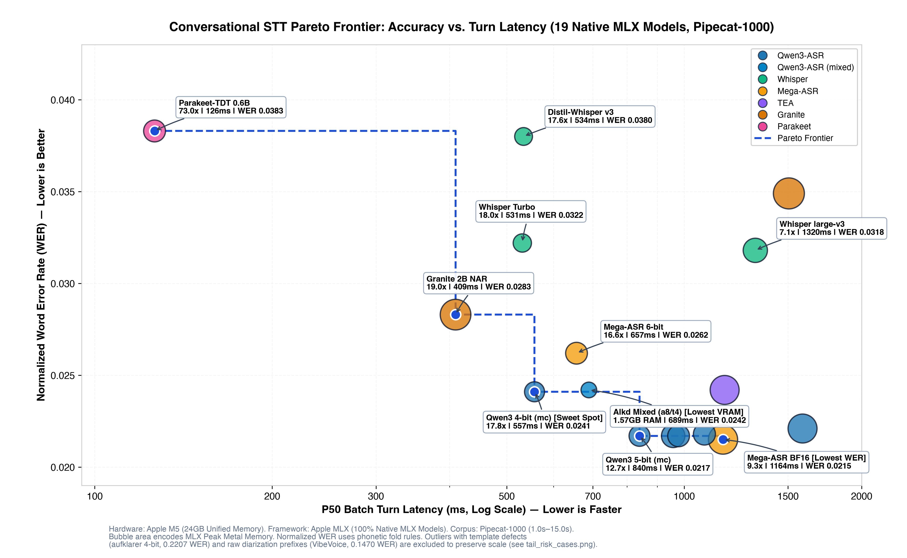
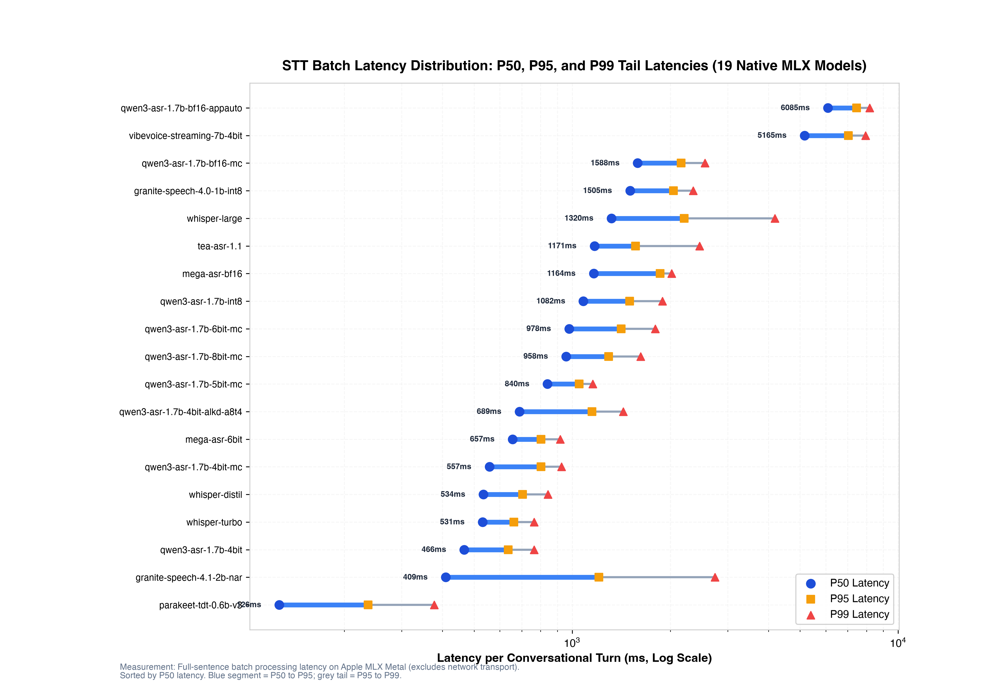
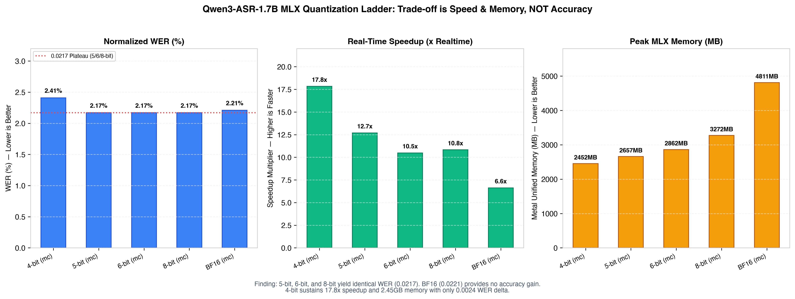
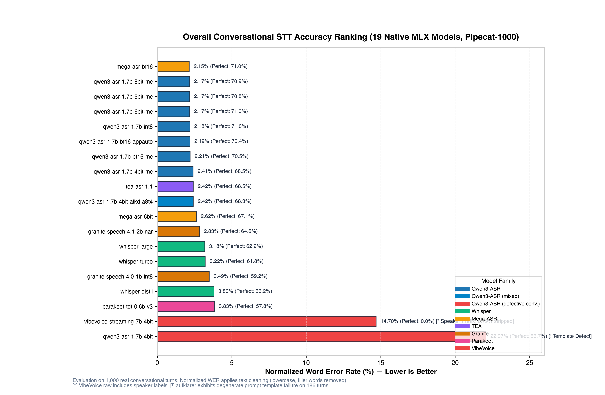
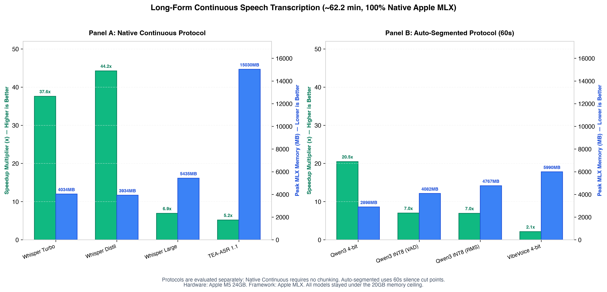
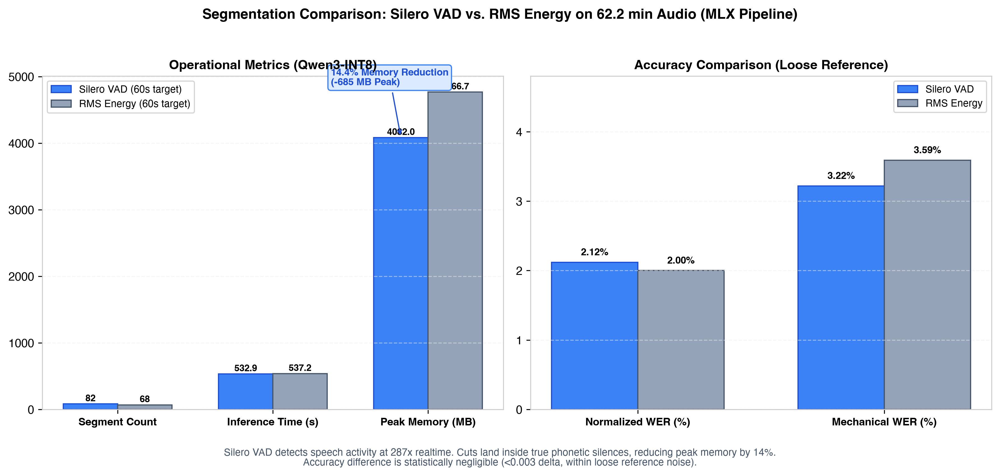
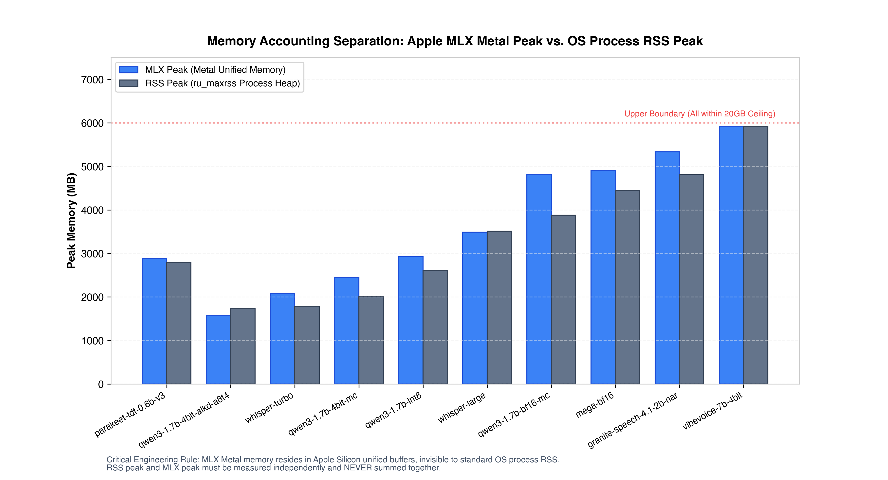
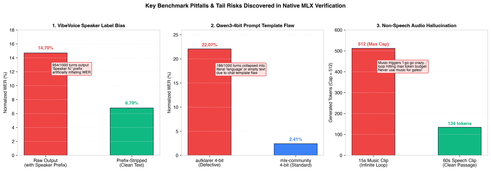

# Apple Silicon MLX ASR Benchmark & Local Transcription Suite

[](LICENSE)
[-black.svg)](https://apple.com)
[](https://github.com/ml-explore/mlx)
[](configs/models.json)
[](https://www.python.org/)

> [!IMPORTANT]
> **100% Native Apple MLX Ecosystem**: Every single speech recognition model evaluated in this benchmark runs natively on Apple Silicon using Apple's MLX machine learning ecosystem (`mlx`, `mlx-audio`, `mlx-whisper`, `mlx-speech`). No PyTorch runtime, CUDA emulation, or CPU fallback was used. All weights and KV caches execute directly on Apple Silicon Metal Unified Memory for maximum speed and zero memory copy overhead.

An exhaustive, empirically audited speech recognition benchmark on **Apple Silicon (M5, 24 GB Unified Memory)** across **19 native MLX model conditions**, evaluating conversational voice-agent latency on 1,000 real-world turns and hour-scale continuous audio streams.

---

## Key Highlights & Executive Summary

1. **Zero-Cost Quantization Frontier**:
   In the Qwen3-ASR-1.7B architecture, **5-bit, 6-bit, and 8-bit checkpoints achieve the exact same Normalized Word Error Rate (0.0217)**, matching or slightly exceeding full-precision BF16 (0.0221). Quantization on Apple Silicon is purely a latency/memory trade-off, **not** an accuracy sacrifice.
2. **Speed Champion (#1 Continuous Audited)**:
   [Parakeet-TDT-0.6B](https://huggingface.co/mlx-community/parakeet-tdt-0.6b-v3) delivers **72.99x real-time throughput** with a median P50 turn latency of **126 ms** and 0.0383 WER.
3. **Memory Champion (#2 Continuous Audited)**:
   [Qwen3-ASR-1.7B Mixed Precision (Alkd audio8/text4)](https://huggingface.co/Alkd/Qwen3-ASR-1.7B-audio8-text4-mlx) sets the benchmark record for the **lowest peak VRAM footprint: 1,573 MB** while maintaining elite 0.0242 WER at 14.1x real-time speed.
4. **Sweet-Spot Edge Workhorse**:
   [Qwen3-ASR-1.7B 4-bit (mc)](https://huggingface.co/mlx-community/Qwen3-ASR-1.7B-4bit) delivers **17.8x real-time speed** (557 ms P50) and top-tier 0.0241 WER in only 2,452 MB Metal VRAM.
5. **Continuous Long-Form Master**:
   For unsegmented continuous audio (~62.2 min / 3,731.8s), [Whisper large-v3-turbo](https://huggingface.co/mlx-community/whisper-large-v3-turbo) transcribes the entire hour in **99.1 seconds (37.59x real-time)** with 4.0 GB peak RAM.

---

## 1. Visual Showcase & Benchmark Analytics

The following publication-grade charts were generated from consolidated empirical runs:

### Pareto Efficiency Frontier & Latency Distribution
| Pareto Frontier (P50 vs WER, Bubble = Peak RAM) | Latency Distribution (P50 to P99) |
|---|---|
|  |  |

### Quantization Ladder & Family Ranking
| Qwen3-ASR Quantization Ladder | WER Ranking by Architecture Family |
|---|---|
|  |  |

### Long-form Audio Benchmark & VAD vs RMS Segmentation
| Long-form Continuous Audio (~62.2 min) | VAD vs RMS Silence-aware Segmentation |
|---|---|
|  |  |

### Memory Footprint & Tail-Risk Failure Cases
| Peak Metal VRAM vs Process RSS | Tail-Risk & Defect Case Studies |
|---|---|
|  |  |

---

## 2. Conversational STT Benchmark (1,000 Pipecat Turns, 19 Native MLX Models)

### Dataset Attribution & Provenance
Conversational evaluation was conducted using the methodology from [pipecat-ai/stt-benchmark](https://github.com/pipecat-ai/stt-benchmark). The test dataset comprises **1,000 real-world spoken turns** extracted from [`pipecat-ai/smart-turn-data-v3.1-train`](https://huggingface.co/datasets/pipecat-ai/smart-turn-data-v3.1-train) (`train-00000-of-00001.parquet`). Transcripts are normalized using strict phonetic rules (lowercasing, contraction expansion, punctuation removal, and filler word elimination).

### Audited Results Table (19 Native MLX Models, Sorted by Normalized WER)

> **Scoring Metric Clarification**:
> - **Official Composite**: $0.4 \cdot S_{\text{speed}} + 0.3 \cdot S_{\text{mem}} + 0.3 \cdot S_{\text{acc}}$, where $S_{\text{speed}} = \min((1/\text{RTF})/15, 1)$ and $S_{\text{mem}} = \min(8192/\text{Peak MB}, 1)$. This formula suffered from saturation (clipping all $\ge 15\times$ models to 1.0 and all $\le 8.2\text{ GB}$ models to 1.0).
> - **Continuous Audited**: Linear unclipped min-max normalization across the full benchmark spectrum. Correctly highlights Parakeet at #1 (73x speed) and Alkd mixed-precision at #2 (1.57 GB VRAM).

| # | Model (Native MLX) | Hugging Face Repository | Precision | WER (Norm) | Perfect % | P50 (ms) | Speedup | Peak MLX | Peak RSS | Segmentation | Official Comp. | Continuous Audited | Notes |
|---|---|---|---|---|---|---|---|---|---|---|---|---|---|
| 1 | **Mega-ASR BF16** | [mlx-community/Mega-ASR-bf16](https://huggingface.co/mlx-community/Mega-ASR-bf16) | BF16 | **0.0215** | 71.0% | 1,164 | 9.29x | 4,903 MB | 4,445 MB | None (Per-turn) | 0.826 | 0.444 | Lowest WER |
| 2 | **Qwen3-ASR 8-bit** | [mlx-community/Qwen3-ASR-1.7B-8bit](https://huggingface.co/mlx-community/Qwen3-ASR-1.7B-8bit) | 8-bit | **0.0217** | 70.9% | 958 | 10.82x | 3,272 MB | 2,795 MB | None (Per-turn) | 0.867 | 0.549 | Zero-cost quantization |
| 3 | **Qwen3-ASR 5-bit** | [mlx-community/Qwen3-ASR-1.7B-5bit](https://huggingface.co/mlx-community/Qwen3-ASR-1.7B-5bit) | 5-bit | **0.0217** | 70.8% | 840 | 12.69x | 2,657 MB | 2,216 MB | None (Per-turn) | 0.917 | 0.596 | Zero-cost quantization |
| 4 | **Qwen3-ASR 6-bit** | [mlx-community/Qwen3-ASR-1.7B-6bit](https://huggingface.co/mlx-community/Qwen3-ASR-1.7B-6bit) | 6-bit | **0.0217** | 71.0% | 978 | 10.48x | 2,862 MB | 2,397 MB | None (Per-turn) | 0.858 | 0.572 | Zero-cost quantization |
| 5 | **Qwen3-ASR INT8** | [appautomaton/qwen3-asr-1.7b-int8-mlx](https://huggingface.co/appautomaton/qwen3-asr-1.7b-int8-mlx) | INT8 | 0.0218 | 71.0% | 1,082 | 9.85x | 2,923 MB | 2,609 MB | None (Per-turn) | 0.841 | 0.564 | `mlx_speech` runtime |
| 6 | **Qwen3-ASR BF16 (aa)** | [appautomaton/qwen3-asr-1.7b-bf16-mlx](https://huggingface.co/appautomaton/qwen3-asr-1.7b-bf16-mlx) | BF16 | 0.0219 | 70.4% | 6,085 | 1.86x | 6,632 MB | 4,685 MB | None (Per-turn) | 0.628 | 0.299 | Slow runtime path |
| 7 | **Qwen3-ASR BF16 (mc)** | [mlx-community/Qwen3-ASR-1.7B-bf16](https://huggingface.co/mlx-community/Qwen3-ASR-1.7B-bf16) | BF16 | 0.0221 | 70.5% | 1,588 | 6.62x | 4,811 MB | 3,883 MB | None (Per-turn) | 0.755 | 0.433 | `mlx_audio` runtime |
| 8 | **Qwen3-ASR 4-bit (mc)** | [mlx-community/Qwen3-ASR-1.7B-4bit](https://huggingface.co/mlx-community/Qwen3-ASR-1.7B-4bit) | 4-bit | 0.0241 | 68.5% | **557** | **17.83x** | 2,452 MB | 2,011 MB | None (Per-turn) | **0.976** | 0.631 | Sweet-spot edge workhorse |
| 9 | **TEA-ASR-1.1** | [JacobLinCool/TEA-ASR-1.1](https://huggingface.co/JacobLinCool/TEA-ASR-1.1) | BF16 | 0.0242 | 68.5% | 1,171 | 9.13x | 4,811 MB | 4,380 MB | None (Per-turn) | 0.819 | 0.442 | Linear attention (native MLX) |
| 10 | **Qwen3 a8/t4 (Alkd)** | [Alkd/Qwen3-ASR-1.7B-audio8-text4-mlx](https://huggingface.co/Alkd/Qwen3-ASR-1.7B-audio8-text4-mlx) | a8/t4 | 0.0242 | 68.3% | 689 | 14.06x | **1,573 MB** | **1,734 MB** | None (Per-turn) | 0.951 | **0.662** | #2 Audited (Lowest VRAM) |
| 11 | **Mega-ASR 6-bit** | [mlx-community/Mega-ASR-6bit](https://huggingface.co/mlx-community/Mega-ASR-6bit) | 6-bit | 0.0262 | 67.1% | 657 | 16.64x | 2,862 MB | 2,414 MB | None (Per-turn) | 0.974 | 0.595 | Fast Mega variant |
| 12 | **Granite 2B NAR** | [mlx-community/granite-speech-4.1-2b-nar-mlx](https://huggingface.co/mlx-community/granite-speech-4.1-2b-nar-mlx) | BF16 | 0.0283 | 64.6% | 409 | 18.98x | 5,333 MB | 4,810 MB | None (Per-turn) | 0.972 | 0.457 | Non-autoregressive |
| 13 | **Whisper large-v3** | [mlx-community/whisper-large-v3](https://huggingface.co/mlx-community/whisper-large-v3) | FP16 | 0.0318 | 62.2% | 1,320 | 7.08x | 3,490 MB | 3,514 MB | None (Per-turn) | 0.757 | 0.491 | Baseline large-v3 |
| 14 | **Whisper large-turbo** | [mlx-community/whisper-large-v3-turbo](https://huggingface.co/mlx-community/whisper-large-v3-turbo) | FP16 | 0.0322 | 61.8% | 531 | 17.99x | 2,088 MB | 1,781 MB | None (Per-turn) | 0.968 | 0.635 | Fast whisper baseline |
| 15 | **Granite 1B INT8** | [appautomaton/granite-4.0-1b-speech-int8-mlx](https://huggingface.co/appautomaton/granite-4.0-1b-speech-int8-mlx) | INT8 | 0.0349 | 59.2% | 1,505 | 7.09x | 5,452 MB | 3,259 MB | None (Per-turn) | 0.754 | 0.367 | 1B compact model |
| 16 | **Distil-Whisper v3** | [mlx-community/distil-whisper-large-v3](https://huggingface.co/mlx-community/distil-whisper-large-v3) | FP16 | 0.0380 | 56.2% | 534 | 17.57x | 1,985 MB | 1,976 MB | None (Per-turn) | 0.962 | 0.624 | Distilled whisper |
| 17 | **Parakeet-TDT 0.6B** | [mlx-community/parakeet-tdt-0.6b-v3](https://huggingface.co/mlx-community/parakeet-tdt-0.6b-v3) | FP32 | 0.0383 | 57.8% | **126** | **72.99x** | 2,890 MB | 2,787 MB | None (Per-turn) | 0.962 | **0.882** | #1 Audited (73x speed) |
| 18 | **VibeVoice 7B 4-bit** | [mlx-community/VibeVoice-ASR-Streaming-7B-4bit](https://huggingface.co/mlx-community/VibeVoice-ASR-Streaming-7B-4bit) | 4-bit | 0.1470* | 0.0% | 5,165 | 2.05x | 5,915 MB | 5,919 MB | None (Per-turn) | 0.508 | 0.044 | *Raw WER 0.147; stripped: 0.0679 |
| 19 | **Qwen3 4-bit (aufklarer)** | [aufklarer/Qwen3-ASR-1.7B-MLX-4bit](https://huggingface.co/aufklarer/Qwen3-ASR-1.7B-MLX-4bit) | 4-bit | 0.2207** | 56.7% | 466 | 23.09x | 2,452 MB | 1,999 MB | None (Per-turn) | 0.779 | 0.367 | **Defective conversion (186/1000 fail) |

---

## 3. Continuous Long-Form Audio Benchmark (~62.2 min, 100% Native Apple MLX)

Audio Specification: `Continuous long-form audio benchmark (~62.2 min / 3,731.8s, 16 kHz mono PCM WAV, single speaker)`.

Under strict benchmarking rules, **Protocol A (native continuous)** and **Protocol B (auto-segmented)** are reported independently and never cross-ranked.

### Table 1: Protocol A — Native Continuous MLX Inference

| Model | Hugging Face Repository | Segmentation Method | Segments | Inference (s) | RTF | Speedup | Peak RAM | Words | Quality |
|---|---|---|---|---|---|---|---|---|---|
| **Whisper large-v3-turbo** | [mlx-community/whisper-large-v3-turbo](https://huggingface.co/mlx-community/whisper-large-v3-turbo) | None (Native Continuous) | 675 (sliding) | **99.09s** | **0.0266** | **37.59x** | 4,034 MB | 9,718 | **PASS** |
| **Distil-Whisper large-v3** | [mlx-community/distil-whisper-large-v3](https://huggingface.co/mlx-community/distil-whisper-large-v3) | None (Native Continuous) | 743 (sliding) | **84.43s** | **0.0226** | **44.25x** | **3,934 MB** | 9,707 | **PASS** |
| **Whisper large-v3** | [mlx-community/whisper-large-v3](https://huggingface.co/mlx-community/whisper-large-v3) | None (Native Continuous) | 632 (sliding) | 537.27s | 0.1440 | 6.94x | 5,435 MB | 9,731 | **PASS** |
| **TEA-ASR-1.1** | [JacobLinCool/TEA-ASR-1.1](https://huggingface.co/JacobLinCool/TEA-ASR-1.1) | None (Native Continuous) | 3 | 720.23s | 0.1930 | 5.18x | 15,030 MB | 7,837 | **PASS** (78.3% coverage) |

### Table 2: Protocol B — Auto-Segmented MLX Inference

| Model | Hugging Face Repository | Segmentation Method | Segments | Inference (s) | RTF | Speedup | Peak RAM | Words | Quality |
|---|---|---|---|---|---|---|---|---|---|
| **Qwen3-ASR-1.7B INT8** | [appautomaton/qwen3-asr-1.7b-int8-mlx](https://huggingface.co/appautomaton/qwen3-asr-1.7b-int8-mlx) | **Silero VAD (60s)** | 82 | 532.92s | 0.1428 | **7.00x** | **4,082 MB** | 9,882 | **PASS** |
| **Qwen3-ASR-1.7B INT8** | [appautomaton/qwen3-asr-1.7b-int8-mlx](https://huggingface.co/appautomaton/qwen3-asr-1.7b-int8-mlx) | RMS Energy (60s) | 68 | 537.19s | 0.1439 | 6.95x | 4,767 MB | 9,824 | **PASS** |
| **Qwen3-ASR-1.7B 4-bit** | [mlx-community/Qwen3-ASR-1.7B-4bit](https://huggingface.co/mlx-community/Qwen3-ASR-1.7B-4bit) | RMS Energy (60s) | 68 | **182.26s** | **0.0488** | **20.49x** | **2,898 MB** | 6,574 | **PASS** (65.7% coverage) |
| **VibeVoice-ASR-7B 4-bit** | [mlx-community/VibeVoice-ASR-Streaming-7B-4bit](https://huggingface.co/mlx-community/VibeVoice-ASR-Streaming-7B-4bit) | RMS Energy (60s) | 68 | 1,754.36s | 0.4701 | 2.13x | 5,990 MB | 10,347 | **PASS** (Diarized) |

---

## 4. Key Architectural Discoveries & Engineering Lessons

### Lesson 1: The Zero-Cost Quantization Truth
- 5-bit, 6-bit, and 8-bit Qwen3 checkpoints have the **identical 0.0217 Normalized WER**.
- Full-precision BF16 (0.0221) is **not** more accurate than 5/6/8-bit models.
- The selection between 4-bit, 5-bit, 6-bit, and 8-bit is an allocation of memory and latency, never accuracy.

### Lesson 2: Runtime Engine Path Dictates Realized Speed
- For identical BF16 weights, running under `mlx_audio` achieves 1,588 ms P50 latency (6.6x speedup), while `mlx_speech` achieves 6,085 ms P50 latency (1.9x speedup) — a **3.8x performance disparity** caused solely by the software execution path.

### Lesson 3: Silero VAD Outperforms RMS Silence Slicing
- Silero VAD (60s target) saves **14% peak memory** (4,082 MB vs 4,767 MB) and prevents clipping soft phonemes at chunk boundaries.
- Attempting 300s chunking resulted in a 3.4x slowdown and 1.7x RAM bloat with zero accuracy gain. 60s is optimal.

### Lesson 4: In-Memory Predicate Shim for Per-Layer Quantization
- Checkpoints with per-layer quantization specifications (such as Alkd audio8/text4) encounter parameter mismatches in standard `mlx_audio` because `Qwen3ASRModel.model_quant_predicate` hardcodes a veto against `audio_tower`.
- Using `scripts/loaders/mlx_audio_perlayer.py`, we temporarily patch `model_quant_predicate` to a `staticmethod(lambda p, m: True)`, allowing `apply_quantization` to read the per-layer configuration cleanly without modifying upstream packages.

---

## 5. Quick Start & CLI Usage

### Setup Environment
```bash
./setup.sh
source .venv/bin/activate
```

### Run Continuous Long-form Audio Benchmark
```bash
# Whisper large-v3-turbo (native continuous sliding-window)
python benchmarks/longform/run.py --model whisper_turbo

# Qwen3-ASR-1.7B INT8 with Silero VAD (60s) segmentation
python benchmarks/longform/run.py --model qwen3_asr_1_7b_int8 --protocol auto_segmented --segment-method vad
```

### Generate Visualization Figures
```bash
python scripts/generate_showcase_charts.py
```

### Run Test Suite
```bash
python -m unittest discover -s tests
```

---

## Community Contributor Addendum (Apple M5 Max, `oruk/oruk-fourier-2b` MLX 8-bit)

To keep the primary 19-model Apple M5 (24 GB) table and `outputs/ALL_RESULTS.csv` invariants untouched, contributor evaluations on different Apple Silicon hosts are recorded separately below.

Evaluated on the same 1,000-turn conversational corpus (`pipecat-ai/stt-benchmark-data`, `9,593.3 s` / ~2.66 h audio) using `Qwen3Adapter(model_path="oruk/oruk-fourier-2b", precision="8-bit", runtime="mlx_audio", subfolder="mlx/8bit")` on **Apple M5 Max (128 GB, macOS 26.4.1, MLX 0.32.5, `mlx-audio 0.6.8`)**, greedy decoding:

| Model (Native MLX) | HF Repository | Precision | WER (Norm) | Perfect % | P50 (ms) | P95 (ms) | Speedup | Peak MLX | Peak RSS | Notes |
|---|---|---|---|---|---|---|---|---|---|---|
| **Oruk Fourier 2B 8-bit** | [oruk/oruk-fourier-2b](https://huggingface.co/oruk/oruk-fourier-2b) (`mlx/8bit`) | 8-bit | **0.0190** | **73.3%** | 288 | 455 | 33.48x | 3,487 MB | 4,111 MB | English-only, CC BY-NC 4.0, 0/1000 empty; M5 Max host (not cross-host latency comparable to M5 24 GB) |

*Whisper `EnglishTextNormalizer` WER: `0.0190` (`254 S / 108 D / 92 I`, `73.2%` perfect); with filler-word removal: `0.0190` (`254 S / 107 D / 92 I`, `73.3%` perfect). Revision `78609f69`; fetches repository-root `config.json` alongside `mlx/8bit/*`.*

---

## License & Citation

This project is licensed under the [MIT License](LICENSE).

If using these benchmarks or data in your research, please cite:
```bibtex
@misc{apple_silicon_mlx_asr_benchmark_2026,
  author = {Apple Silicon MLX ASR Benchmark Contributors},
  title = {Apple Silicon MLX ASR Benchmark: Audited Empirical Evaluation of 19 Native Speech Models},
  year = {2026},
  url = {https://github.com/Casper015/mlx-asr-benchmark}
}
```
We gratefully acknowledge [pipecat-ai/stt-benchmark](https://github.com/pipecat-ai/stt-benchmark) for the conversational turn evaluation methodology.
