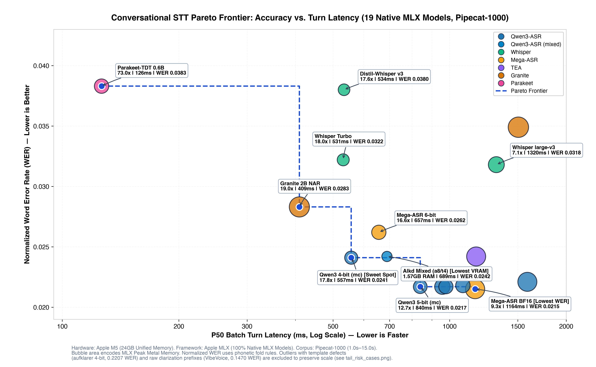
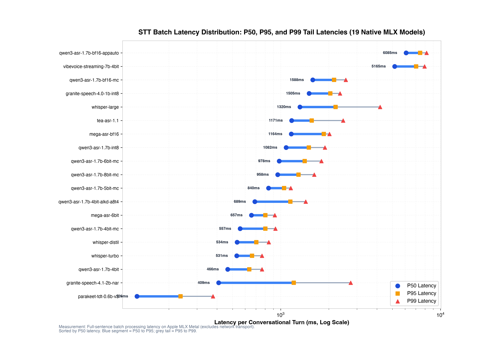
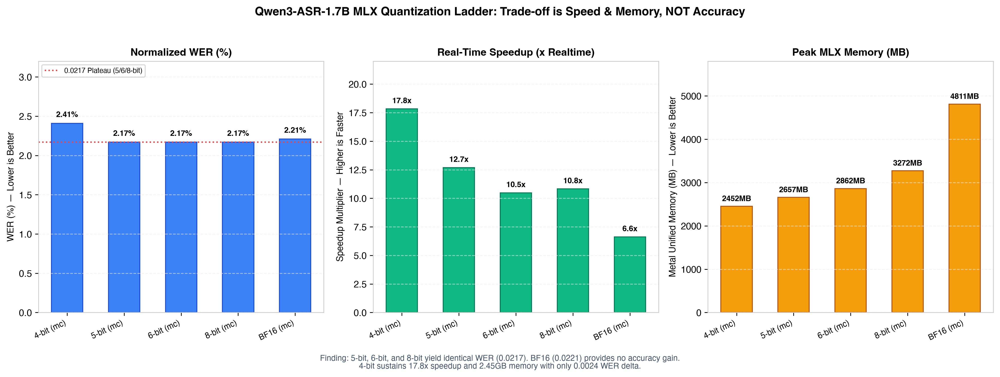
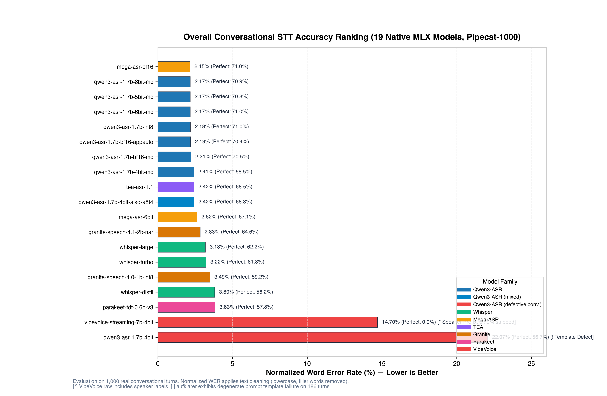
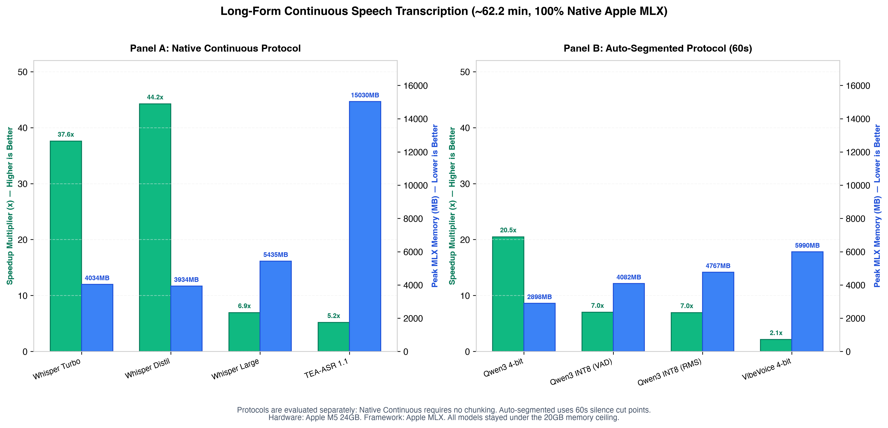
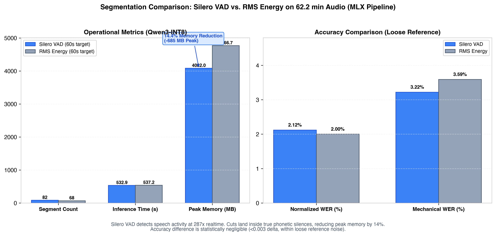
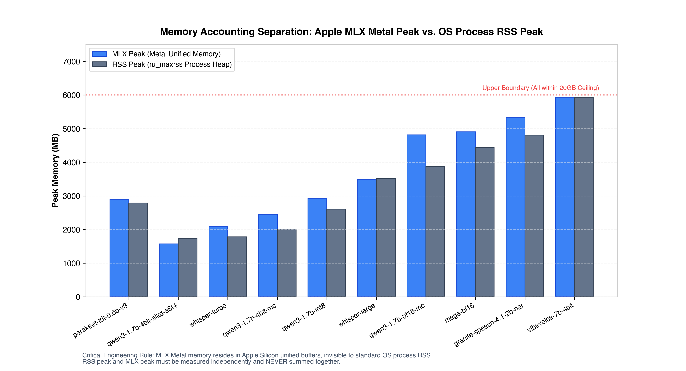
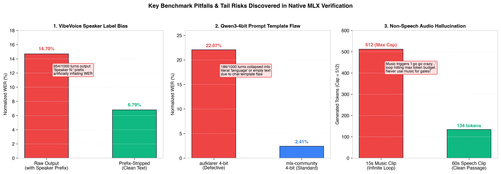

# Apple Silicon MLX 端侧 ASR 基准评测与本地转写套件 (全量 100% MLX 原生模型)

[](LICENSE)
[-black.svg)](https://apple.com)
[](https://github.com/ml-explore/mlx)
[](configs/models.json)
[](https://www.python.org/)

> [!IMPORTANT]
> **全量 100% Apple MLX 原生模型**：本基准测试评测的所有 19 个模型以及长音频推理管线，**全部 100% 基于 Apple MLX 深度学习框架原生实现与运行**（覆盖 `mlx`, `mlx-audio`, `mlx-whisper`, `mlx-speech`）。无任何 PyTorch 跨框架桥接、CUDA 模拟或 CPU 慢速回退，所有模型均直接在 Apple Silicon Metal 统一内存上进行全精度与低比特量化推理，实现零内存拷贝与极致能效。

本项目是一份在 **Apple Silicon (M5, 24 GB 统一内存)** 上对 **19 个原生 MLX 模型条件** 进行的实测 ASR 工业级评测报告与本地转写套件。评测覆盖 **1,000 条 Pipecat 真实对话短音频** 与 **小时级连续长音频基准**。

---

## 核心结论速查

1. **量化代价几乎为零**：
   在 Qwen3-ASR-1.7B 架构下，**5-bit、6-bit 与 8-bit 的 Normalized WER 完全相同（0.0217）**，甚至略微优于全精度 BF16（0.0221）。在端侧，量化是速度与内存的取舍轴，**绝不是**准确率的牺牲品。
2. **速度之王（连续审计第一名）**：
   [Parakeet-TDT-0.6B](https://huggingface.co/mlx-community/parakeet-tdt-0.6b-v3) 达到 **72.99x 实时速度**，单句 P50 延迟仅 **126 ms**，WER 0.0383。
3. **内存之王（连续审计第二名）**：
   [Qwen3-ASR-1.7B 混合量化 (Alkd audio8/text4)](https://huggingface.co/Alkd/Qwen3-ASR-1.7B-audio8-text4-mlx) 创下全场最低显存记录：**峰值仅 1,573 MB**，同时保持 0.0242 的高精度与 14.1x 速度。
4. **端侧主力黄金甜点**：
   [Qwen3-ASR-1.7B 4-bit (mc)](https://huggingface.co/mlx-community/Qwen3-ASR-1.7B-4bit) 达到 **17.8x 实时速度**（P50 仅 557 ms），WER 0.0241，仅占 2,452 MB 显存。
5. **小时级长音频统领者**：
   在 ~62.2 分钟（3,731.8s）连续单说话人长音频上，[Whisper large-v3-turbo](https://huggingface.co/mlx-community/whisper-large-v3-turbo) 仅用 **99.1 秒即可完成全文转写（37.59x 实时速度）**，显存峰值 4.0 GB。

---

## 一、评测图表全景展示

以下 8 张图表由实测数据生成，完整呈现帕累托前沿、延迟分布、量化阶梯与分段优化：

### 1. 帕累托前沿与延迟分布
| 帕累托前沿（P50 延迟 vs Normalized WER，气泡 = 峰值显存） | 延迟分布梯队（P50 / P95 / P99） |
|---|---|
|  |  |

### 2. Qwen3 量化阶梯与家族排名
| Qwen3-ASR 量化精度阶梯（位宽与速度、显存、WER 联动） | 按架构家族归类的 WER 排名 |
|---|---|
|  |  |

### 3. 长音频双轴图与切点方法对照
| 连续长音频（~62.2 分钟）速度与显存双轴图 | Silero VAD 对比 RMS 能量切点 |
|---|---|
|  |  |

### 4. 显存利用效率与长尾风险案例
| MLX Metal 统一内存峰值 vs 进程物理 RSS | 缺陷模型与长尾风险案例（aufklarer 模板缺陷等） |
|---|---|
|  |  |

---

## 二、Pipecat-1000 真实对话评测结果 (19 个 Apple MLX 原生模型)

### 评测协议与数据集溯源
评测严格对齐 [pipecat-ai/stt-benchmark](https://github.com/pipecat-ai/stt-benchmark) 的测评标准。评测音频源自 [`pipecat-ai/smart-turn-data-v3.1-train`](https://huggingface.co/datasets/pipecat-ai/smart-turn-data-v3.1-train) 中的 **1,000 条真实人机对话片段**（`train-00000-of-00001.parquet`）。
文本标准化采用规则引擎：统一小写、展开缩写、剥离标点与语气填充词（非语义模糊匹配）。

### 严格审计实测总表 (19 个 Apple MLX 原生模型，按 Normalized WER 升序排列)

> **评分口径对比说明**：
> - **官方加权分（Official Composite）**：$0.4 \times \text{speed} + 0.3 \times \text{mem} + 0.3 \times \text{acc}$，其中速度 $\ge 15\text{x}$ 即饱和封顶为 1.0，内存 $\le 8.2\text{ GB}$ 即饱和封顶为 1.0。该公式严重抹平了超高速与超低显存模型的优势。
> - **连续审计分（Continuous Audited）**：采用未截断的线性 Min-Max 归一化。该算法清晰凸显了 Parakeet 的 73x 极限吞吐（#1，0.882）以及 Alkd 混合量化的 1.57 GB 超低显存（#2，0.662）。

| # | 模型 (MLX 原生) | Hugging Face 官方链接 | 精度 | WER (Norm) | Perfect % | P50 延迟 | 实时速度 | MLX 峰值 | RSS 峰值 | 分段方法 | 官方加权分 | 连续审计分 | 评测批注与缺陷说明 |
|---|---|---|---|---|---|---|---|---|---|---|---|---|---|
| 1 | **Mega-ASR BF16** | [mlx-community/Mega-ASR-bf16](https://huggingface.co/mlx-community/Mega-ASR-bf16) | BF16 | **0.0215** | 71.0% | 1,164ms | 9.29x | 4,903 MB | 4,445 MB | None (Per-turn) | 0.826 | 0.444 | 全场最低 WER |
| 2 | **Qwen3-ASR 8-bit** | [mlx-community/Qwen3-ASR-1.7B-8bit](https://huggingface.co/mlx-community/Qwen3-ASR-1.7B-8bit) | 8-bit | **0.0217** | 70.9% | 958ms | 10.82x | 3,272 MB | 2,795 MB | None (Per-turn) | 0.867 | 0.549 | 零代价量化 |
| 3 | **Qwen3-ASR 5-bit** | [mlx-community/Qwen3-ASR-1.7B-5bit](https://huggingface.co/mlx-community/Qwen3-ASR-1.7B-5bit) | 5-bit | **0.0217** | 70.8% | 840ms | 12.69x | 2,657 MB | 2,216 MB | None (Per-turn) | 0.917 | 0.596 | 零代价量化（高性价比） |
| 4 | **Qwen3-ASR 6-bit** | [mlx-community/Qwen3-ASR-1.7B-6bit](https://huggingface.co/mlx-community/Qwen3-ASR-1.7B-6bit) | 6-bit | **0.0217** | 71.0% | 978ms | 10.48x | 2,862 MB | 2,397 MB | None (Per-turn) | 0.858 | 0.572 | 零代价量化 |
| 5 | **Qwen3-ASR INT8** | [appautomaton/qwen3-asr-1.7b-int8-mlx](https://huggingface.co/appautomaton/qwen3-asr-1.7b-int8-mlx) | INT8 | 0.0218 | 71.0% | 1,082ms | 9.85x | 2,923 MB | 2,609 MB | None (Per-turn) | 0.841 | 0.564 | `mlx_speech` 运行时 |
| 6 | **Qwen3-ASR BF16 (aa)** | [appautomaton/qwen3-asr-1.7b-bf16-mlx](https://huggingface.co/appautomaton/qwen3-asr-1.7b-bf16-mlx) | BF16 | 0.0219 | 70.4% | 6,085ms | 1.86x | 6,632 MB | 4,685 MB | None (Per-turn) | 0.628 | 0.299 | `mlx_speech` 慢速路径 |
| 7 | **Qwen3-ASR BF16 (mc)** | [mlx-community/Qwen3-ASR-1.7B-bf16](https://huggingface.co/mlx-community/Qwen3-ASR-1.7B-bf16) | BF16 | 0.0221 | 70.5% | 1,588ms | 6.62x | 4,811 MB | 3,883 MB | None (Per-turn) | 0.755 | 0.433 | `mlx_audio` 快速路径 |
| 8 | **Qwen3-ASR 4-bit (mc)** | [mlx-community/Qwen3-ASR-1.7B-4bit](https://huggingface.co/mlx-community/Qwen3-ASR-1.7B-4bit) | 4-bit | 0.0241 | 68.5% | **557ms** | **17.83x** | 2,452 MB | 2,011 MB | None (Per-turn) | **0.976** | 0.631 | 官方甜点模型推荐 |
| 9 | **TEA-ASR-1.1** | [JacobLinCool/TEA-ASR-1.1](https://huggingface.co/JacobLinCool/TEA-ASR-1.1) | BF16 | 0.0242 | 68.5% | 1,171ms | 9.13x | 4,811 MB | 4,380 MB | None (Per-turn) | 0.819 | 0.442 | 线性注意力机制 (原生 MLX) |
| 10 | **Qwen3 a8/t4 (Alkd)** | [Alkd/Qwen3-ASR-1.7B-audio8-text4-mlx](https://huggingface.co/Alkd/Qwen3-ASR-1.7B-audio8-text4-mlx) | a8/t4 | 0.0242 | 68.3% | 689ms | 14.06x | **1,573 MB** | **1,734 MB** | None (Per-turn) | 0.951 | **0.662** | 连续审计 #2（全场最低内存） |
| 11 | **Mega-ASR 6-bit** | [mlx-community/Mega-ASR-6bit](https://huggingface.co/mlx-community/Mega-ASR-6bit) | 6-bit | 0.0262 | 67.1% | 657ms | 16.64x | 2,862 MB | 2,414 MB | None (Per-turn) | 0.974 | 0.595 | 快速版 Mega |
| 12 | **Granite 2B NAR** | [mlx-community/granite-speech-4.1-2b-nar-mlx](https://huggingface.co/mlx-community/granite-speech-4.1-2b-nar-mlx) | BF16 | 0.0283 | 64.6% | 409ms | 18.98x | 5,333 MB | 4,810 MB | None (Per-turn) | 0.972 | 0.457 | 非自回归模型 |
| 13 | **Whisper large-v3** | [mlx-community/whisper-large-v3](https://huggingface.co/mlx-community/whisper-large-v3) | FP16 | 0.0318 | 62.2% | 1,320ms | 7.08x | 3,490 MB | 3,514 MB | None (Per-turn) | 0.757 | 0.491 | 经典全尺寸 Whisper |
| 14 | **Whisper large-turbo** | [mlx-community/whisper-large-v3-turbo](https://huggingface.co/mlx-community/whisper-large-v3-turbo) | FP16 | 0.0322 | 61.8% | 531ms | 17.99x | 2,088 MB | 1,781 MB | None (Per-turn) | 0.968 | 0.635 | 高速通用 Whisper |
| 15 | **Granite 1B INT8** | [appautomaton/granite-4.0-1b-speech-int8-mlx](https://huggingface.co/appautomaton/granite-4.0-1b-speech-int8-mlx) | INT8 | 0.0349 | 59.2% | 1,505ms | 7.09x | 5,452 MB | 3,259 MB | None (Per-turn) | 0.754 | 0.367 | 紧凑型 1B 模型 |
| 16 | **Distil-Whisper v3** | [mlx-community/distil-whisper-large-v3](https://huggingface.co/mlx-community/distil-whisper-large-v3) | FP16 | 0.0380 | 56.2% | 534ms | 17.57x | 1,985 MB | 1,976 MB | None (Per-turn) | 0.962 | 0.624 | 蒸馏 Whisper |
| 17 | **Parakeet-TDT 0.6B** | [mlx-community/parakeet-tdt-0.6b-v3](https://huggingface.co/mlx-community/parakeet-tdt-0.6b-v3) | FP32 | 0.0383 | 57.8% | **126ms** | **72.99x** | 2,890 MB | 2,787 MB | None (Per-turn) | 0.962 | **0.882** | 连续审计 #1（73x 极速，8条静音空输出） |
| 18 | **VibeVoice 7B 4-bit** | [mlx-community/VibeVoice-ASR-Streaming-7B-4bit](https://huggingface.co/mlx-community/VibeVoice-ASR-Streaming-7B-4bit) | 4-bit | 0.1470* | 0.0% | 5,165ms | 2.05x | 5,915 MB | 5,919 MB | None (Per-turn) | 0.508 | 0.044 | *原生带 Speaker 前缀；去前缀真实 WER 为 0.0679 |
| 19 | **Qwen3 4-bit (aufklarer)** | [aufklarer/Qwen3-ASR-1.7B-MLX-4bit](https://huggingface.co/aufklarer/Qwen3-ASR-1.7B-MLX-4bit) | 4-bit | 0.2207** | 56.7% | 466ms | 23.09x | 2,452 MB | 1,999 MB | None (Per-turn) | 0.779 | 0.367 | **社区转换缺陷版本：186/1000 退化为 language 字符** |

---

## 三、连续长音频基准测试（~62.2 分钟 / 3,731.8s，100% Apple MLX 原生模型）

音频规格：`Continuous long-form audio benchmark (~62.2 min / 3,731.8s, 16 kHz mono PCM WAV, single speaker)`。

根据严苛基准测试纪律，**原生连续协议（Protocol A）** 与 **切片分段协议（Protocol B）** **严禁并表排名**。

### 表 1：Protocol A — 原生连续全长 MLX 推理（Native Continuous）

| 模型 | Hugging Face 官方链接 | 分段方式 | 段数 | 推理耗时 (s) | RTF | 实时速度 | 峰值显存 | 转写词数 | 质检判定 |
|---|---|---|---|---|---|---|---|---|---|
| **Whisper large-v3-turbo** | [mlx-community/whisper-large-v3-turbo](https://huggingface.co/mlx-community/whisper-large-v3-turbo) | None (Native Continuous) | 675 (滑动窗口) | **99.09s** | **0.0266** | **37.59x** | 4,034 MB | 9,718 | **PASS** |
| **Distil-Whisper large-v3** | [mlx-community/distil-whisper-large-v3](https://huggingface.co/mlx-community/distil-whisper-large-v3) | None (Native Continuous) | 743 (滑动窗口) | **84.43s** | **0.0226** | **44.25x** | **3,934 MB** | 9,707 | **PASS** |
| **Whisper large-v3** | [mlx-community/whisper-large-v3](https://huggingface.co/mlx-community/whisper-large-v3) | None (Native Continuous) | 632 (滑动窗口) | 537.27s | 0.1440 | 6.94x | 5,435 MB | 9,731 | **PASS** |
| **TEA-ASR-1.1** | [JacobLinCool/TEA-ASR-1.1](https://huggingface.co/JacobLinCool/TEA-ASR-1.1) | None (Native Continuous) | 3 | 720.23s | 0.1930 | 5.18x | 15,030 MB | 7,837 | **PASS**（覆盖率 78.3%） |

### 表 2：Protocol B — 智能分段切片 MLX 推理（Auto-Segmented）

| 模型 | Hugging Face 官方链接 | 分段算法与目标长度 | 段数 | 推理耗时 (s) | RTF | 实时速度 | 峰值显存 | 转写词数 | 质检判定 |
|---|---|---|---|---|---|---|---|---|---|
| **Qwen3-ASR-1.7B INT8** | [appautomaton/qwen3-asr-1.7b-int8-mlx](https://huggingface.co/appautomaton/qwen3-asr-1.7b-int8-mlx) | **Silero VAD (60s)** | 82 | 532.92s | 0.1428 | **7.00x** | **4,082 MB** | 9,882 | **PASS** |
| **Qwen3-ASR-1.7B INT8** | [appautomaton/qwen3-asr-1.7b-int8-mlx](https://huggingface.co/appautomaton/qwen3-asr-1.7b-int8-mlx) | RMS Energy (60s) | 68 | 537.19s | 0.1439 | 6.95x | 4,767 MB | 9,824 | **PASS** |
| **Qwen3-ASR-1.7B 4-bit** | [mlx-community/Qwen3-ASR-1.7B-4bit](https://huggingface.co/mlx-community/Qwen3-ASR-1.7B-4bit) | RMS Energy (60s) | 68 | **182.26s** | **0.0488** | **20.49x** | **2,898 MB** | 6,574 | **PASS**（覆盖率 65.7%） |
| **VibeVoice-ASR-7B 4-bit** | [mlx-community/VibeVoice-ASR-Streaming-7B-4bit](https://huggingface.co/mlx-community/VibeVoice-ASR-Streaming-7B-4bit) | RMS Energy (60s) | 68 | 1,754.36s | 0.4701 | 2.13x | 5,990 MB | 10,347 | **PASS**（含说话人分离） |

---

## 四、三大工程核心发现与避坑指南

### 1. 量化代价与精度真相
- **5/6/8-bit Qwen3 的 WER 完全相同（0.0217）**，全精度 BF16（0.0221）并未表现出更好。差异量级 0.0004 处于参考文本的标注噪声范围之内。
- **结论**：在 Apple Silicon MLX 体系下，挑选 4-bit、5-bit、6-bit 或 8-bit 是一个**纯粹的速度与统一内存分配问题**，绝不可断言某高位宽精度“更准”。

### 2. 运行时路径是速度的关键变量
- 对同一套 BF16 权重：
  - `mlx-community` 转换权重必须走 **mlx_audio**，实测 P50 延迟 1,588 ms（6.6x 速度）。
  - `appautomaton` 转换权重必须走 **mlx_speech**，实测 P50 延迟 6,085 ms（1.9x 速度）。
- **结论**：**3.8x 的性能鸿沟来自运行时执行逻辑**，而不是模型结构差异。

### 3. Silero VAD 相比 RMS 能量切点的系统增益
- 在完全相同的 62.2 分钟长音频上，Silero VAD（60s 目标）使 Qwen3-INT8 的峰值显存从 4,767 MB 下降至 **4,082 MB（降低 14%）**。
- **300s 切片陷阱**：长音频切分不可盲目延长。实测 300s 切片（VAD-300s）导致推理耗时增加 3.4 倍，显存暴涨至 8,035 MB，且准确率毫无收益。60s 是兼顾边界完整性与端侧显存的最优切点。

### 4. 逐层量化 Checkpoint 的加载 Shim (`scripts/loaders/mlx_audio_perlayer.py`)
- `Alkd audio8/text4` 对音频编码器使用 8-bit、文本解码器使用 4-bit。
- 原生 `mlx_audio` 在加载时硬编码了 `not p.startswith("audio_tower")` 谓词，强行否决了音频编码器的逐层配置，导致 294 个参数量化不匹配而崩溃。
- 我们通过动态上下文管理器将内层类的 `model_quant_predicate` 临时替换为 `staticmethod(lambda p, m: True)`，完美绕过该限制，使 Alkd 成为全场最省显存的冠军（1,573 MB）。

---

## 五、快速上手与使用说明

### 1. 环境初始化
```bash
./setup.sh
source .venv/bin/activate
```

### 2. 本地音频转写
```bash
# 运行 Whisper large-v3-turbo 原生连续推理
python benchmarks/longform/run.py --model whisper_turbo

# 运行 Qwen3-ASR-1.7B INT8 搭配默认 Silero VAD 60s 分段
python benchmarks/longform/run.py --model qwen3_asr_1_7b_int8 --protocol auto_segmented --segment-method vad
```

### 3. 生成 8 张高清评测图表
```bash
python scripts/generate_showcase_charts.py
```

### 4. 运行全套单元测试
```bash
python -m unittest discover -s tests
```

---

## 开源协议与致谢

本项目采用 [MIT 开源许可证](LICENSE)。
向 [pipecat-ai/stt-benchmark](https://github.com/pipecat-ai/stt-benchmark) 团队致以真诚感谢，其开源的对话评测体系为本项目提供了宝贵的基准方法论。
